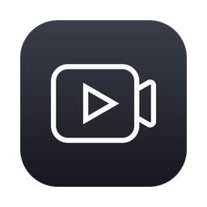

<p align="center"></p>

# Simpla Recorder

A tiny menu-bar screen recorder for macOS 15+.
Records a whole screen, a single window or a selected area — with system audio and/or microphone — to MP4 or MOV (H.264 / HEVC).

## Install

Requires macOS 15 or later on an Apple Silicon Mac.

1. Download `SimplaRecorder.zip` from the [latest release](../../releases/latest) and unzip it.
2. Move **Simpla Recorder.app** to the **Applications** folder.
3. The app is not notarized by Apple, so macOS blocks the first launch. Either:
   - open it once, then go to **System Settings → Privacy & Security**, scroll down and click **Open Anyway**; or
   - run this in Terminal: `xattr -dr com.apple.quarantine "/Applications/Simpla Recorder.app"`
4. Launch it. There is no Dock icon — look for the camera icon in the menu bar.
5. On the first recording macOS asks for **Screen & System Audio Recording** access (and for the microphone,
   if you enable it). Allow it in System Settings → Privacy & Security, then quit and reopen the app.

## Usage

The menu-bar icon has four items: **Record Screen**, **Settings…**, **Open Recordings Folder** and **Quit**.

1. **Record Screen** dims the screens. Click a window to pick it, press **Entire Screen**, or drag to select an area
   (a dragged area can then be resized by its borders or corners and moved by dragging inside it).
2. A small panel lets you turn the microphone and system audio on or off for this recording, then start it.
3. While recording, the menu-bar item becomes a stop button with the elapsed time.
   Click it to stop.
4. A small preview appears in the bottom-left corner for 5 seconds. Hover it for **Save** (show in Finder),
   **Copy** (put the video on the clipboard) or **Delete** (move to Trash); otherwise it fades out and the file stays saved.

## Build

Only the Command Line Tools are required (no Xcode).

```sh
./build.sh           # build and install /Applications/Simpla Recorder.app
./build.sh run       # same, then launch it
./build.sh release   # build an ad-hoc signed SimplaRecorder.zip for distribution
```

Build products go to `~/Library/Caches/SimplaRecorder-build`, not the project folder.
Local builds are signed with `CODESIGN_IDENTITY`, else the first code-signing certificate in the keychain, else ad-hoc.

## Permissions

On the first recording macOS asks for access: System Settings → Privacy & Security → Screen & System Audio Recording.
The microphone is requested separately. With ad-hoc signing you may have to grant access again after each rebuild.

## Settings

**Settings…**: format, codec, quality (maximum resolution, from 360p to original), frame rate, default microphone / system audio, start at login, and the output folder
(default `~/Movies/Simpla Recorder`). Stored in `UserDefaults` (`com.simpla.recorder`).
Recordings are named `Screen Recording yyyy-MM-dd HH.mm.ss`.
